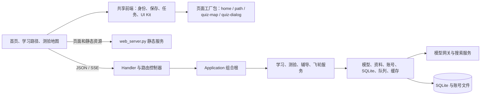
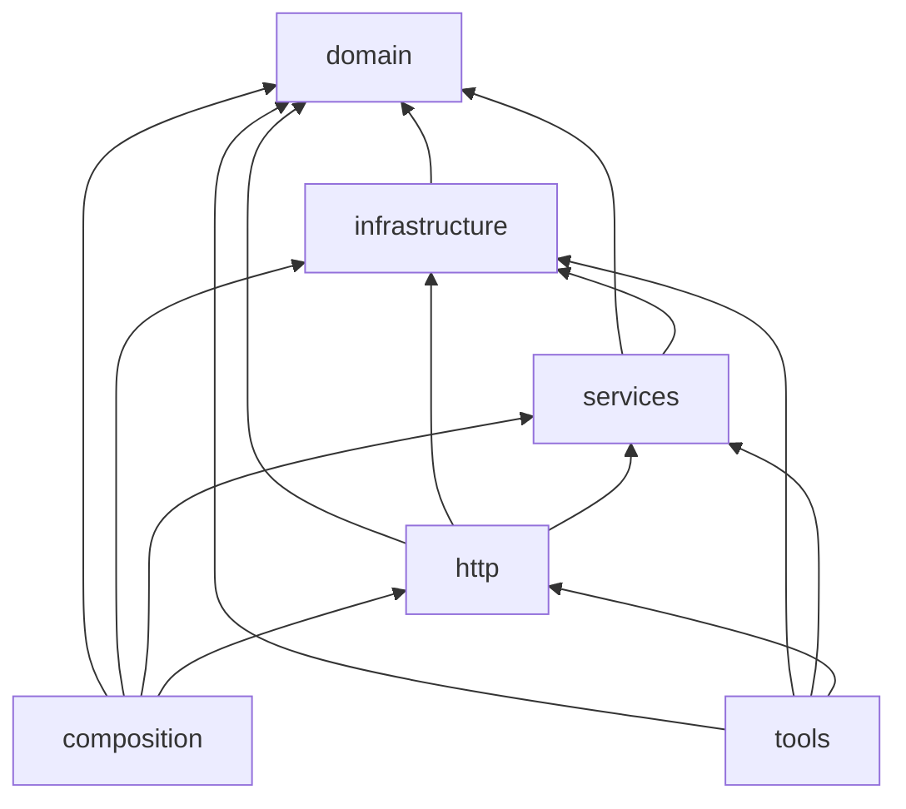
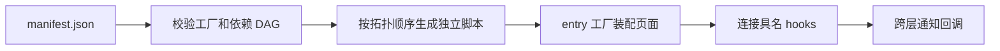

# 系统架构

本文描述仓库当前源码和清单定义的模块边界。它说明设计约束，不代表已经发布或完成线上验证。

## 运行结构



浏览器静态服务与 API 服务分开运行。静态服务生成 `/learn/config.js`，页面从中读取 API 地址。API 使用标准库 HTTP 服务，通过模型客户端访问配置的上游。

## Python 后端

`study-assistant/architecture.json` 为每个 Python 文件声明唯一层级。`scripts/check_architecture.py` 校验文件归属、导入方向、本地与外部导入、依赖环，以及页面资源顺序。允许的依赖方向如下：



`domain` 只依赖自身。`infrastructure` 可依赖领域规则。`services` 编排领域与基础设施。`http` 适配请求并调用服务。只有组合层负责构造整套应用。开发工具可以调用运行模块，但运行代码不导入工具或启动入口。

| 层 | 文件 | 职责 |
| --- | --- | --- |
| composition | `study_assistant.py`, `application.py` | 读取配置、持有单实例锁、创建应用；注册服务操作和 HTTP 路由；启动后台任务与服务器。 |
| http | `http_handler.py`, `http_io.py`, `account_routes.py`, `state_routes.py`, `path_routes.py`, `job_routes.py`, `material_routes.py`, `tutor_routes.py` | 处理 HTTP、请求体与流式响应；按账号、状态、路径、任务、资料和辅导功能分派请求。 |
| services | `learning_service.py`, `quiz_service.py`, `quiz_generation.py`, `flywheel_service.py`, `request_auth.py` | 执行学习阶段、测验与验题、薄弱点和细化流程；集中处理请求授权。 |
| infrastructure | `background_jobs.py`, `generation_cache.py`, `material_parser.py`, `material_repository.py`, `model_client.py`, `render_review.py`, `state_schema.py`, `state_store.py`, `user_accounts.py` | 提供持久任务队列、缓存、资料解析、资料仓库、上游客户端、渲染检查、Schema 校验、SQLite 和账号存储。 |
| domain | `app_config.py`, `flywheel.py`, `generation_contracts.py`, `material_titles.py`, `path_hierarchy.py`, `prompts.py`, `quiz_harness.py`, `research_sources.py`, `service_limits.py`, `text_utils.py` | 定义配置边界、路径和飞轮规则、生成结果规范、标题、测验协议、研究来源策略、限额、提示词及文本处理。 |
| tools | `backup_state.py`, `material_worker.py`, `migrate_quiz_v2.py`, `render_worker.py`, `web_server.py` | 备份数据、隔离解析上传、执行测验迁移、隔离渲染检查、提供静态页面和用户路径路由。 |

### 组合与调用

启动入口 `study_assistant.py` 调用 `create_application()`。`application.py` 创建账号与 SQLite 存储、资料仓库、模型客户端、缓存和业务服务，再将具体依赖注入各路由对象。`Handler` 只通过服务器上的 `application` 属性访问应用，不负责创建业务对象。

路径操作由 `Application.operations` 注册。同步路径请求经 `PathRoutes` 调用 `dispatch`；后台任务由 `JobQueue` 执行 `Application.run_job()`，重新检查用户状态、操作权限和资料存在性后，再调用同一个操作注册表。后台队列不构造或伪造 HTTP handler。

### 外部转换边界

上传资料经 `material_parser.py` 启动 `material_worker.py`。生产调用使用 `bubblewrap` 建立无网络、清空环境、低权限、限时和限资源的临时沙箱。解析器不把用户提供的路径解包到磁盘，也不执行上传内容。Office、PDF、图像和压缩包转换器属于外部依赖；安装与运行配置由部署环境管理。

`render_review.py` 使用隔离的 `render_worker.py` 生成检查截图。渲染工作进程只允许读取配置目录中的静态资源，并拦截其他请求。渲染不可用时会报告不可用，不会当作检查通过。

## 浏览器模块

首页、学习路径、测验地图和测验窗口使用原生 JavaScript。`home/manifest.json` 与 `learning-path/manifest.json` 声明模块 ID、工厂源文件、依赖和输出包。`bundle_builder.py` 校验源文件声明与清单一致，检查缺失和循环依赖，再按拓扑顺序生成独立脚本。浏览器运行时只解析已注册工厂，不使用 `eval` 或动态函数执行。



页面模块只通过声明的依赖读取显式接口。需要跨模块回调的页面使用单独的 hooks 工厂。入口工厂对 `connect()` 传入具名回调；hooks 检查每个函数、拒绝重复连接，并将回调冻结。hooks 只转发调用，不保存业务状态。

| 页面包 | 主要职责 |
| --- | --- |
| `home.js` | `platform` 提供身份、公共 UI 和 API；`admin` 管理账号；`account` 管理密码；`library` 读写资料入口；`tasks` 展示和恢复后台任务；`entry` 根据当前身份装配页面。 |
| `path_app.js` | `model` 持有页面状态；`domain` 处理依赖与进度规则；`format` 负责格式化；`persistence` 访问服务端；`shell` 管理阶段与状态；`workflow` 管理采集、研究与路径生成；`cards` 绘制路径；`generation` 生成单元资料；`assistant` 处理 AI 对话；`assessment` 管理测验；`library` 管理资料窗口；`entry` 连接 hooks 并启动页面。 |
| `quiz-map-app.js` | `model`、`format` 与 `identity` 管理测验地图数据；`network` 访问后端；`view` 渲染题目和成绩；`catalog` 管理试卷目录与生成；`diagnosis` 管理诊断和补习；`entry` 连接 hooks 并启动页面。 |
| `quiz_dialog.js` | `question` 处理题型与答案显示；`model` 保存窗口状态；`network` 访问接口；`drafts` 管理草稿和版本；`view` 渲染题目及状态；`controller` 管理交互；`entry` 连接 hooks 并发布 `QuizDialog.open`。 |

学习页面的 `path.hooks` 由入口连接 `renderDocumentTitle`、`renderPlan`、`selectNode`、`genAllStart`、`genQuizMap`、`renderAgentPanel`、`showAgent`、`requestNodeDetail`、`syncAiMaterial` 和 `renderNodeDetail`。测验地图 hooks 连接 `renderGaps`、`runGaps`、`runRefine`。测验窗口 hooks 连接 `status`、`renderSaveState`、`updateProgress`。业务模块通过 hooks 调用这些公开回调，不直接读取高层模块内部状态。

共享脚本使用 `shared/manifest.json` 声明全局接口和依赖。它们按 HTML 顺序加载，不参与页面工厂包：`ui.js`、`user-shell.js`、`user-session.js`、`saves.js`、`jobs.js`、`titles.js`、`materials.js`、Markdown vendor 与 `markdown.js`。第三方文件保留 vendor 来源和独立清单，不改写为本项目模块。

## 构建、门禁与发布包

修改模块源后运行：

```sh
python3 scripts/build_frontend.py
python3 learning-path/gen_path_page.py
sh scripts/check-local.sh
```

第一个命令生成首页包、共享 UI 样式和首页资源。第二个命令生成学习路径包、测验地图包、测验窗口包及两个 HTML 页面。`--check` 模式只核对生成结果。不要手改生成文件；需要修改时编辑源文件和模板后重新生成。

架构门禁验证 Python 层级、导入 DAG、前端工厂 manifest、页面资源和脚本加载顺序。UI Kit 门禁检查控件契约。`check-local.sh` 还运行后端与前端测试、JavaScript 语法检查和 Python 编译检查。发布工具从已提交且工作区干净的 `HEAD` 读取明示文件清单，生成 `backend.tar.gz`、`site.tar.gz` 和含文件及归档 SHA-256 的 `release.json`。后端列表来自 `architecture.json`；站点包显式列出共享资源、首页和页面生成产物。第三方 KaTeX/highlight 资源按部署环境提供。部署流程不得用仅覆盖 `*.py` 的通配符代替发布清单。`install_release.py` 校验归档成员与哈希，再安装测试或正式环境允许的文件，并保留代码文件回滚快照；它不把学习数据放进代码归档。

本地门禁通过后，还须按顺序完成测试与正式环境的同版本部署及浏览器回归。发布验收以实际部署版本和回归记录为准。
