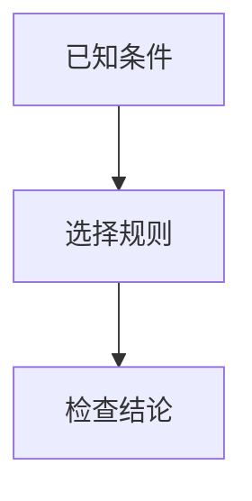

# Markdown 教学内容

模型可以按需采用文字、例子、推导、表格及图示；并不要求每条回复都含图。学习材料、AI回复与两个测验入口使用相同渲染模块 `shared/markdown.js`。

## 支持语法

普通 Markdown 标题、列表、加粗、代码、表格；现有 KaTeX 公式使用 `$...$`。关系/流程与时序图采用 Mermaid 代码围栏：

当前支持 `flowchart`、`graph`、`sequenceDiagram`，不支持配置指令、HTML标签、click或外部图片加载。流程图不表示精确几何比例。图前后的文字必须说明符号及关系，不依赖图才能理解知识点。

## 校验与恢复

模型输出前检查语法完整性、数值及图文一致性；浏览器另行解析图示，失败时保留源码、周围正文和修正提示。语法通过不等于知识语义正确。流式回复完成前图块保持等待，未闭合围栏不绘图。单图上限8000字符/100边，复杂内容应拆小。

隐藏测验答案的图只在用户显式确认查看后渲染，不改变既有评分和答案展示流程。模型不得把解法嵌入题干图。AI对于未生成材料只作明确的预习说明。

原始Markdown随材料和完整AI回复保存；打开历史重新渲染。正文及AI回复可导出Markdown，图可单独下载SVG。导出的MD需在支持Mermaid的阅读器中渲染，不支持的阅读器仍保留图示源码。手机可放大、缩放和滚动查看图。

## 依赖和验证

本地托管 @mermaid-js/tiny 12.0.0 与 markdown-it 15.0.2，来源为官方npm包；文件校验值见 `shared/vendor-manifest.json`，许可证随文件保留。Mermaid仅出现待渲染图时加载，不依赖运行时CDN。Mermaid严格模式，结果作为隔离SVG图片展示，临时绘图容器不可见。

- `sh scripts/check-local.sh`
- `PLAYWRIGHT_MODULE=<playwright模块路径> node tests/test_markdown_browser.cjs`

部署需包含 shared 目录的新增JS/CSS依赖。生成入口：`python3 learning-path/gen_path_page.py`。

## 表格边界与公式复制

模型输出表格时，表格前后留空行，每行带首尾竖线且列数一致，表后说明另起段落。共享渲染器只对已解析出的顶层多列表格进行有限容错：至少一行完整竖线数据后，剩余各行不含竖线，首行是至少12字符且以句末标点结束的说明，才在显示时将说明与表格分开。单列、简短稀疏行、显式空单元格、代码围栏及含竖线的歧义行保持原状；嵌套表格不自动推断。故意省略全部分隔符的长说明式数据行仍有歧义，应写成显式表格行。此处理不修改存储原文或导出源文件，也不重新请求模型。

完整公式复制的旧版LaTeX定界符行为已由下方“学生端自动降级与导出”规则替代；原始Markdown导出保持不变。

## 学生端自动降级与导出

公式由共享渲染器逐个调用本地 KaTeX（支持 `$...$`、`$$...$$`、`\(...\)`、`\[...\]`）。单个错误或组件不可用时显示完整表达式及简短说明，不清空正文；不推断错误公式应改成什么。完整公式复制同时提供基本HTML与纯文本，从MathML结构保留括号、分式及上下标，不依赖目标应用支持LaTeX。求和上下限、矩阵等未明确支持的结构保留完整TeX；局部选区仍走原生复制，不改变无障碍MathML。简单富文本使用sup/sub，不能保证粘贴到每个应用都保留排版。

流程图失败时，仅对全部可解析的简单 `A["名称"] --> B["名称"]` 关系给出文字版；含分支标签、时序、其他语法或冲突定义时不猜测关系，保留相邻讲解及源码。图像显示失败也局部降级，失效的图示操作按钮移除。模型仍需提供独立于图的讲解；程序不能凭空重建知识解释。流式未完成的图等待结束，不提前判失败。

脚注引用 `[^1]` 与定义 `[^1]: 说明` 展示为可读编号和补充说明；不依赖脚注跳转插件。NOTE/TIP/IMPORTANT/WARNING/CAUTION提示块转成中文标题的说明块。代码内标记保持原样，不允许任意HTML，隐藏注释不能承载正文知识。

单元导出名为 `课程标题_L序号_单元标题.md`，课程取唯一的文档顶层title，序号与页面同为plan.nodes顺序，标题取当前节点title。缺失时使用“学习资料”“L未编号”“未命名单元”。清理控制字符和文件系统非法字符，每个标题按UTF-8最多96字节截断，保留全部组成部分和扩展名。下载正文仍是原始Markdown，历史数据不重写。

## 实际截图复核

学习材料、换题和综合测验生成后，对含公式、表格、图或注释的候选执行复核：隔离Chromium加载已部署共享渲染器与本地KaTeX资源，生成960px与390px页面截图，与原文一起交给系统当前配置模型。题干、提交后答案分区标识，复核不改变学生端答案展示权限。流式AI对话沿用程序局部兜底与输出前自检，不额外阻塞每段流式文本。

运行时配置位于后端旁 `render-review.json`（不入库），包含隔离Python路径和本环境静态站点根目录。截图进程仅允许读取本地渲染资源，不携带登录会话，不访问外部URL；图片通过内存传给现有模型网关，不保存截图到学生资料。每次截图最多75秒、模型复核60秒，每视口最多10000px，图片总量8MiB；超出或依赖故障记录 `unavailable`，不声称检查通过。确定的语法/内容问题转为现有最多3次生成循环的修正反馈；用尽次数按原失败流程保留旧材料/题集。通过记录source_sha256、截图数量和视口，不能把视觉复核视为数学正确性的绝对保证。

部署先在测试环境配置截图运行时并真实调用当前模型验证，随后部署相同代码到正式环境；配置、账号和学习数据独立。回归：`tests/test_render_review.py`、`tests/test_student_markdown_browser.cjs`，后者支持BASE_URL验证已部署资源，或KATEX_DIR验证本地资源。

截图运行时在当前服务器使用Playwright Python 1.58.0及其Ubuntu24.04兼容Chromium构建（已实测服务器可运行）；单独虚拟环境，不替换后端Python。进程超时会终止整个截图进程组，防止遗留浏览器占用资源。
