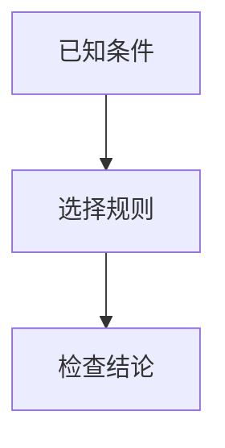

# Markdown 教学内容

模型可以按需采用文字、例子、推导、表格及图示；并不要求每条回复都含图。学习材料、AI回复与两个测验入口使用相同渲染模块 `shared/markdown.js`。

## 支持语法

普通 Markdown 标题、列表、加粗、代码、表格；现有 KaTeX 公式使用 `$...$`。关系/流程与时序图采用 Mermaid 代码围栏：

当前支持 `flowchart`、`graph`、`sequenceDiagram`，不支持配置指令、HTML标签、click或外部图片加载。流程图不表示精确几何比例。图前后的文字必须说明符号及关系，不依赖图才能理解知识点。

## 校验与恢复

模型输出前检查语法完整性、数值及图文一致性；浏览器另行解析图示，失败时保留源码、周围正文和修正提示。语法通过不等于知识语义正确。流式回复完成前图块保持等待，未闭合围栏不绘图。单图上限8000字符/100边，复杂内容应拆小。

隐藏测验答案的图只在用户显式确认查看后渲染，不改变既有评分和答案展示流程。模型不得把解法嵌入题干图。AI对于未生成材料只作明确的预习说明。

原始Markdown随材料和完整AI回复保存；打开历史重新渲染。正文及AI回复可导出Markdown，图可单独下载SVG。导出的MD需在支持Mermaid的阅读器中渲染，不支持的阅读器仍保留图示源码。手机可放大、缩放和滚动查看图。

## 依赖和验证

本地托管 @mermaid-js/tiny 12.0.0 与 markdown-it 15.0.2，来源为官方npm包；文件校验值见 `shared/vendor-manifest.json`，许可证随文件保留。Mermaid仅出现待渲染图时加载，不依赖运行时CDN。Mermaid严格模式，结果作为隔离SVG图片展示，临时绘图容器不可见。

- `sh scripts/check-local.sh`
- `PLAYWRIGHT_MODULE=<playwright模块路径> node tests/test_markdown_browser.cjs`

部署需包含 shared 目录的新增JS/CSS依赖。生成入口：`python3 learning-path/gen_path_page.py`。
